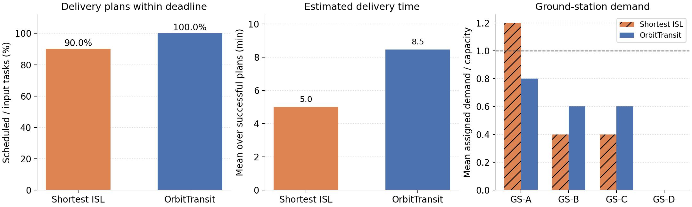

# OrbitTransit

**Satellite data delivery through orbital motion and traffic diffusion.**

OrbitTransit is a Python simulator for delay-tolerant delivery over a moving
satellite network. It models orbital visibility, inter-satellite links, ground
station capacity and satellite resources, then compares delivery strategies on
the same traffic workload.

The central idea is that data can remain on a moving satellite until a suitable
ground station becomes reachable. When necessary, it can move to a neighboring
orbital plane or use an immediate ISL route. Choosing where and how to deliver
data changes both the delivery time and the demand placed on ground stations.

## From scenario to result


The included scenario has 396 synthetic satellites, four ground stations and
20 traffic tasks per interval. Six five-minute intervals produce 120 tasks per
strategy. Ground stations and traffic sources are fixed geographic coordinates;
all deadlines are generated once with seed 123 and shared by both strategies.

| Strategy | Ground station assignment | Delivery choice |
| --- | --- | --- |
| Shortest ISL | Nearest station | Fewest-hop path through the current ISL graph |
| OrbitTransit | Capacity-aware assignment with orbital traffic diffusion | Orbital carrying or an ISL route, subject to deadline and resource checks |

This comparison includes both station assignment and routing.



In this small scenario, nearest-station assignment overloads GS-A and schedules
108 of 120 tasks. OrbitTransit spreads demand and schedules all 120, with a longer
mean estimated delivery time because some plans wait for orbital motion. The
dashed line marks configured station capacity. These are results for this
synthetic scenario, not measurements of an operational constellation.

## Run the example

Use **Python 3.12**. From the repository root, on Linux or macOS:

```bash
python3.12 -m venv .venv
source .venv/bin/activate
python -m pip install -e '.[dev]'
python -m orbittransit --config examples/demo.json --output results/demo
```

The simulation takes a few seconds on the development machine. Dependency
installation is separate. The scenario is self-contained: no private dataset,
external solver or network access is required once dependencies are installed.
The output directory must be new or empty.

| Output | Contents |
| --- | --- |
| `comparison.png`, `comparison.pdf` | The three-panel result figure |
| `tasks.csv` | Every input task, selected plan, deadline and success/failure status |
| `stations.csv` | Assigned demand and scheduled tasks at each ground station |
| `resources.csv` | Satellite storage and battery state after each interval |
| `summary.csv` | Per-strategy totals and estimated delivery time |
| `run.json` | Resolved configuration, dependency versions and input/source hashes |

To regenerate the figure from the saved CSV tables:

```bash
python -m orbittransit.reporting results/demo
```

## Change the ground station capacity

The second configuration changes only station capacity, from 10 to 20 Gbps:

```bash
python -m orbittransit --config examples/higher_capacity.json --output results/higher_capacity
```

| Station capacity | Shortest ISL: scheduled / input | OrbitTransit: scheduled / input |
| --- | --- | --- |
| 10 Gbps | 108 / 120 | 120 / 120 |
| 20 Gbps | 118 / 120 | 120 / 120 |

Higher station capacity removes the baseline's overload failures; its two
remaining failures are battery-budget constraints. Both configurations use the
same workload. The [second figure](docs/figures/higher_capacity.png) and saved
summaries are included alongside the default result.

You can also edit station coordinates, traffic locations and counts, constellation
parameters, or resource budgets in the JSON configuration. The units are explicit
in parameter names. See [the model and configuration notes](docs/model.md) for
the supported inputs and metric definitions.

## Implementation and checks

The package separates [orbital geometry](src/orbittransit/orbit.py),
[station allocation](src/orbittransit/allocation.py) and
[routing](src/orbittransit/routing.py) from the scenario runner. Routing candidates
are evaluated without changing satellite state. The selected plan is checked
before its storage and energy reservations are committed.

```bash
python -m pytest -q
```

Tests cover expected paths on a small topology, disconnected or unavailable
links, deadline fallback, storage and energy limits, station admission, unchanged
state for unselected candidates, and reproducible scenario inputs. GitHub Actions
runs the tests and both examples on Python 3.12.

## Model scope

- A single synthetic circular-orbit shell and a distance-filtered ISL grid.
- Equal-size traffic chunks originating at configured geographic points.
- One-minute sampled orbital contact maps and five-minute default planning intervals.
- Predicted delivery plans, with simplified storage, energy and per-interval station capacity accounting.

The simulator does not execute packet-level protocols or replay measured network
traffic. Orbital carrying estimates and resource accounting are explained in
[the model notes](docs/model.md). The examples are a small reproducible extraction
of the research implementation, rather than a full paper experiment suite.

## Background and attribution

The OrbitTransit models, delivery strategies, simulator and experiment analysis
were developed by **Haoyuan Zhao**. This repository packages the existing work
into independent examples with synthetic inputs.

The TLE designator and satellite-distance helpers follow
[Hypatia's satgenpy](https://github.com/snkas/hypatia/tree/master/satgenpy),
copyright ETH Zurich, under its MIT license. Their copyright and permission notice
are retained in [third_party/Hypatia-LICENSE](third_party/Hypatia-LICENSE).
See [NOTICE](NOTICE) for the attribution boundary.
