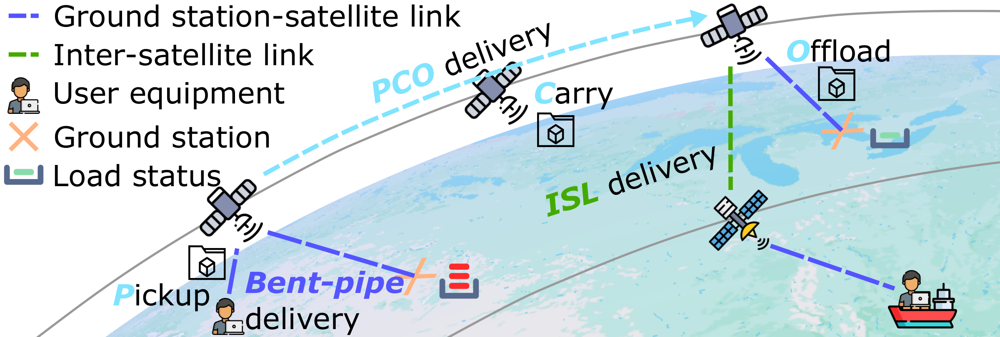

# OrbitTransit

Python code for satellite data delivery using orbital motion and inter-satellite links.

[Paper](https://doi.org/10.1145/3745756.3809199) · [Run the example](#quick-start) · [Model notes](docs/model.md) · [Tests](#tests)

> This is a simplified version of OrbitTransit, not the full implementation evaluated in our MobiSys 2026 paper. The examples use synthetic workloads and simplified routing and resource accounting; they do not reproduce the paper's results.

Rather than forwarding all data immediately through inter-satellite links (ISLs), a satellite can carry it until a suitable ground station comes into view. ISLs allow data to move between orbital planes when carrying alone is not enough. The simulator compares this approach with nearest-station assignment and shortest-hop ISL routing.

<p align="center">
  
</p>

*Delivery modes illustrated in the paper ([original figure](docs/figures/paper_delivery_overview.pdf)). This is a conceptual illustration, not output from the demo.*

## Quick start

Use **Python 3.12**, preferably in a virtual environment. From the repository root:

```bash
python -m pip install -e ".[dev]"
python -m orbittransit --config examples/demo.json --output results/demo
```

The example needs no external dataset or solver. Choose a new or empty output directory for each run.

```text
results/demo/
├── summary.csv       # Totals and estimated delivery time for each strategy
├── tasks.csv         # Task deadlines, selected paths and planning outcomes
├── stations.csv      # Assigned demand and scheduled tasks at each station
├── resources.csv     # Satellite storage and battery state
├── run.json          # Configuration, versions and input/source hashes
├── comparison.png    # Local result plot
└── comparison.pdf
```

A scheduled task means the simulator found a feasible delivery plan. Delivery times are predictions, not observed completion times; ground-station load is assigned demand, not measured arrivals. See [metric definitions](docs/model.md#output-semantics) before interpreting the results.

## Example: ground-station capacity

The [default scenario](examples/demo.json) has **396 satellites**, four ground stations and 120 tasks per strategy over six five-minute intervals. Both strategies receive the same tasks and deadlines.

| Strategy | Station selection | Delivery |
| :--- | :--- | :--- |
| `shortest_isl` | Nearest station | Fewest-hop path in the current ISL graph |
| `orbittransit` | Capacity-aware assignment with orbital traffic diffusion | Carrying or an ISL path, checked against deadlines and resource budgets |

Station selection and routing both change in this comparison; it is not a routing-only experiment.

To repeat the scenario with station capacity increased from **10 to 20 Gbps**:

```bash
python -m orbittransit --config examples/higher_capacity.json --output results/higher_capacity
```

The two configurations differ only in station capacity. Compare their `summary.csv` and `stations.csv` files to see how capacity affects feasible plans and assigned demand. Other parameters, including station locations, traffic sources and satellite budgets, can be changed in the JSON files.

## Code and model

[`orbit.py`](src/orbittransit/orbit.py) builds the constellation, ISL graph and contact maps. [`allocation.py`](src/orbittransit/allocation.py) selects ground stations; [`routing.py`](src/orbittransit/routing.py) constructs delivery candidates. [`simulation.py`](src/orbittransit/simulation.py) runs each planning interval and records the results.

The [model notes](docs/model.md) describe the assumptions, resource units and differences from the paper, including the scheduling and evaluation components omitted from this version.

## Tests

```bash
python -m pytest -q
```

Tests check small-topology routes, unreachable links, deadlines, storage and battery limits, station admission, and repeatable scenario inputs. GitHub Actions is configured to run the tests and both examples on Python 3.12.

## Paper

Haoyuan Zhao, Long Chen, Yi Ching Chou, Hao Fang, and Jiangchuan Liu.  
[**OrbitTransit: Traffic Delivery and Diffusion for Earth Observation via Satellite Mobility.**](https://doi.org/10.1145/3745756.3809199) ACM MobiSys, 2026.

The figure above is reproduced from the paper; its source and attribution are recorded in [NOTICE](NOTICE). The orbital helpers include code derived from [Hypatia's satgenpy](https://github.com/snkas/hypatia/tree/master/satgenpy), with its license retained in [third_party/Hypatia-LICENSE](third_party/Hypatia-LICENSE).
